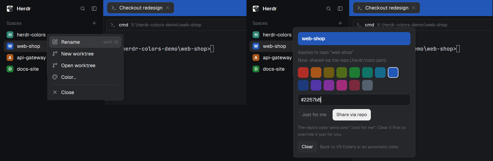

<h1 align="center">herdr-colors</h1>

<p align="center">
  <strong>Every project its own color in <a href="https://herdr.dev">Herdr</a>,<br>
  so you always know which project you're typing into.</strong>
</p>

<p align="center">
  <a href="#install">Install</a> ·
  <a href="#setting-a-color">Pick a color</a> ·
  <a href="#where-colors-come-from">Where colors come from</a> ·
  <a href="#what-it-runs-and-writes">What it runs</a> ·
  <a href="docs/user-stories.md">User stories</a>
</p>

<p align="center">
  
  <br>
  <sub>Three projects, three colors: each space's tile in the sidebar matches its tab bar.
  Shown together here; Herdr shows one space at a time.</sub>
</p>

Working in many Herdr spaces at once (a `web-shop` here, an `api-gateway` there, a `docs-site`
in a dev container) makes it easy to type into the wrong one. herdr-colors paints each project
in its own color everywhere you look, like per-project title bars in VS Code.

### Pick a color with a right-click

<p align="center">
  
  <br>
  <sub>Right-click a space and choose <b>Color...</b> (left) to open the picker (right). This repo
  already shares its color, so <b>Just for me</b> is greyed out: the repo's color would win.</sub>
</p>

## What you get

| Where | What you see |
|---|---|
| **Tab bar** | The bar behind your tabs takes the project's color |
| **Spaces sidebar** | Each space's letter tile in its project's color |
| **Machines** | A tile per machine: a dev container in its project's color, any other machine a color of its own |
| **Agents panel** | A color stripe on every agent, so you see which project each one works in |
| **Window title** | Your OS window title shows the space, e.g. `web-shop - Herdr` |

> [!NOTE]
> A *space* is Herdr's place for one piece of work: its tabs and terminals. A project can have
> several, and they all share its color.

## What you can do

- **Pick a color where you see it.** Right-click a space and choose **Color...**, or right-click
  a machine or agent to open the picker directly.
- **Share it with your team.** **Share via repo** saves it in the repo (`.herdr/color.json`), so
  everyone using Herdr on that repo sees the same color.
- **Keep it to yourself.** **Just for me** saves it only on your computer.
- **Do nothing at all.** Every repo gets one of 14 easy-to-tell-apart colors automatically, and
  keeps it.
- **Reuse VS Code colors.** A title bar color set in VS Code (or with Peacock) is picked up.
- **Dev containers included.** They show their project's color, even while stopped.

> [!TIP]
> It stays out of the way: it writes files only when you click a button, runs almost nothing in
> the background, and shows edits within a second ([What it runs and writes](#what-it-runs-and-writes)).
> Installing takes a few commands and switches you to a copy of Herdr's layout called `colors`,
> which you can leave at any time ([Install](#install)).

## Setting a color

Right-click a space, a machine, an agent or an agents-panel space header:

- **Space:** the menu has **Color...**
- **Machine or agent:** the color picker opens straight away

The picker shows which repo the color applies to (for example `Applies to repo "web-shop" · 2
spaces`) and where the current color comes from. Pick a swatch or type a hex value (with or
without `#`; Enter saves just for you, unless the repo sets the color), then:

| Button | What it does |
|---|---|
| **Just for me** | Saves in your own file, `~/.config/herdr-app/project-colors.json`, on this computer. Disabled while the repo's `.herdr/color.json` sets the color, since that would win; Clear it first |
| **Share via repo** | Writes `.herdr/color.json` in the repo (in a worktree: the file that sets the color now, else the main checkout's). Others see it once you commit it. Only offered when the space is in a git repo that can be reached |
| **Clear** | Removes the project's herdr colors: your personal entry, then the repo's `.herdr/color.json` (worktree and main checkout). The project goes back to its VS Code color, else an automatic one. Disabled when there's nothing to clear or the repo can't be reached |

## Where colors come from

First match wins:

1. `.herdr/color.json` in the repo: `{ "color": "#1d4ed8" }` (in a worktree, the worktree's
   own, then the main checkout's)
2. Your file `~/.config/herdr-app/project-colors.json`:
   `{ "vscode": true, "repos": { "<repo name>": "#1d4ed8" } }`. Set `"vscode": false` to ignore
   VS Code colors.
3. VS Code's `.vscode/settings.json` (JSONC): `workbench.colorCustomizations` →
   `titleBar.activeBackground`, or `peacock.color`
4. Automatic: one of 14 colors chosen to be easy to tell apart, all readable with white text.
   A new repo gets the one fewest projects use, and keeps it (remembered in Herdr's shared
   state). With more than 14 projects, colors repeat.

A project is its git repo, named after the main checkout, so worktrees share their repo's
color (bare-repo layouts like `proj.git` or `proj/.bare` too). Repo names match regardless of
letter case and Unicode form, so two different repos with the same folder name share a color
unless one has its own `.herdr/color.json`. A space outside any git repo is colored by its
space name; its automatic color isn't remembered and can change as projects are added. Repos
at a network path (`\\server\share`) get no reads or writes and are colored by space name; a
mapped drive letter counts as local.

**Machines** reached with a plain `docker exec` or `podman exec` (a full path, `--context` or
`-H` are fine, as is a bare `sudo` in front, which is then run with `-n` so it never asks for a
password) are colored as the repo inside them, found through the container's
`devcontainer.config_file` label: read on your disk when that config file is really on this
computer, else inside the container while it runs (the label's path, or the dev containers
default `/workspaces/<repo>`). A stopped container keeps the color it last had; one never seen
running uses your file or the automatic color of its repo name. Other machines (ssh, or a
target with anything else in front of `docker`) get the automatic color of their name;
`docker compose` targets and Herdr's temporary machines are skipped. While a machine is
unreachable, its spaces keep their last color.

Other file activity in your repos (builds, installs, agents editing code) wakes nothing; see
the table below for exactly what runs when.

## What it runs and writes

So you know before installing:

| What | When |
|---|---|
| `git rev-parse` in a space's folder, on that space's machine | Once per space and folder (again when its first terminal moves to another folder). Every minute only where it found no repo, or the repo vanished, or the machine didn't answer. Never on a machine where git can't run (no git, or macOS without developer tools) |
| `docker inspect` (or `podman inspect`, with `sudo -n` if the machine's target uses `sudo`) of each dev container | Once per container, and once more after it disconnects. A failed inspect (engine not running) is tried again each minute |
| `hc machine ls --json` | At start, every minute, after a color change, and when your `project-colors.json` changes |
| Reads `.herdr/color.json` and `.vscode/settings.json` in each repo, and your `project-colors.json` | Every minute. The `.herdr` and `.vscode` folders of local repos, and Herdr's home folder (only changes to your `project-colors.json` count), are also watched, so an edit there shows within a second (a `.herdr` folder created by hand: within a minute) |
| Reads each known local repo's `.git/HEAD` (or `.git` in a worktree) and a dev container's config file on your disk; for a space on another machine, `git rev-parse --show-toplevel` there instead | Every minute (to notice a repo that vanished, a folder that became its own repo, or a container that moved) |
| Reads a running dev container's config file inside it, at `/workspaces/<repo>`, when the label doesn't say where the repo is | Until found, once a minute while the container runs |
| Writes or removes `<repo>/.herdr/color.json`: through PowerShell on Windows (the path is never parsed by `cmd.exe`), through `sh` elsewhere and in containers (paths and text sent base64-encoded, so nothing in them is interpreted). Refuses if `.herdr` or `color.json` is a link or a folder, or the repo folder isn't there; never creates more than `.herdr` itself. Clear also removes a `.DS_Store` in `.herdr`, and `.herdr` itself once empty. The picker shows the exact folder before you click | Only when you click **Share via repo** or **Clear** |
| Writes `~/.config/herdr-app/project-colors.json`, keeping everything else in it; refuses if it has a typo | Only when you click **Just for me** or **Clear** |

Both files are read as JSON with comments allowed, but a save writes plain JSON: comments in
them are not kept.

Protection against hostile repos and images: a repo that tracks `.herdr` or `.vscode` as a
link has them ignored (never read, watched or written); a repo whose reported top level doesn't
contain your folder is ignored; a container label's folder is used only if it is a git repo on
this computer.
| Sets the OS window title to `<space> - Herdr` | On every space switch |

It opens no network connections of its own. Commands it runs can, as they would anyway: git on
a repo, `docker inspect` on an engine chosen by `-H` or `--context` in a machine's target, and
anything Herdr itself does to reach a machine. Its shared-state entries (`project-color.*`)
hold repo names and folder paths, which any other Herdr mod can read, as with all shared
state. It replaces three of Herdr's
panels (tab bar, agents, spaces) with patched copies and adds a patched copy of its menu, used
for the space right-click only (next section), and writes Herdr shared-state keys:
`space.colors` (Herdr's own map of space colors: a hex color set there by hand is left alone,
Herdr's own automatic picks are replaced) and `project-color.*`.

## Install

Built and tested with herdr-app 0.1.16 and herdr-core (`hc`) 0.1.21 on Windows. Linux and
macOS were reviewed and their shell scripts tested on Linux, but not yet run in a real Herdr
there; reports welcome.

You need:

- **node** (18 or newer) and **jq** (1.6 or newer). macOS: `brew install node jq`. Windows:
  `winget install OpenJS.NodeJS.LTS jqlang.jq`. Debian/Ubuntu: `sudo apt install nodejs jq`;
  Fedora: `sudo dnf install nodejs jq`.
- The **`herdr-app`** command. On macOS it's installed as `~/.local/bin/herdr-app`, which may
  not be on your PATH; use the full path or add `~/.local/bin`.
- **git** in each environment your spaces run in (2.5 or newer). For **Share via repo** inside a
  container or on another machine, that machine also needs `sh`, `base64` and `mktemp` (all
  standard on Linux and macOS).

Run the commands in a POSIX shell: Terminal on macOS, your shell on Linux, **Git Bash** on
Windows. Get the repo and work from its folder, and set `H` to Herdr's home once (it honours
`$HERDR_APP_HOME`):

```sh
git clone https://github.com/kjlibsol/herdr-colors.git
cd herdr-colors
H="${HERDR_APP_HOME:-$HOME/.config/herdr-app}"
```

The tab bar, agents panel, spaces sidebar and right-click menu are Herdr's own mods with small
patches. They are not in this repo: `tools/build-clones.mjs` builds them from the copies in
your Herdr, so they always match your version.

1. Build the patched copies:

   ```sh
   node tools/build-clones.mjs
   ```

   If Herdr changed the code a patch hooks into, it stops with a message and writes nothing.

2. Copy the five mods into Herdr's home and check them. Use real copies: a junction or
   symlink isn't picked up. This overwrites any earlier `project-color*` folders there.

   ```sh
   for m in project-color project-color-tabs project-color-agents project-color-spaces project-color-menu; do
     cp -r "mods/$m" "$H/mods/" && herdr-app check "$H/mods/$m" || { echo "stopped at $m"; break; }
   done
   ```

   If a check fails, stop here: nothing visible has changed yet. Fix it, or delete the copied
   `$H/mods/project-color*` folders to back out.

3. Herdr's shipped `main` layout can't take new blocks, so clone it (this also switches to it).
   If you already have a `colors` layout from an earlier install, skip this step.

   ```sh
   herdr-app do layout.clone --name main --as colors
   ```

4. In the clone, add a 0px `project-color` block (it draws nothing; it looks colors up) and
   point the panels at the patched copies. This works on a clone of Herdr's `main` layout; for
   another layout, make the same two changes by hand (the block first in the column holding the
   tab bar, and `tabs`, `agents`, `spaces` renamed to `project-color-…`). Running it twice is
   harmless.

   ```sh
   F="$H/layouts/colors.json"
   jq '(.children[] | select(.id=="work") | .children) |= ([{"id":"project-color","type":"block","size":{"px":0},"content":{"mod":"project-color","props":{"bar":false}}}] + map(select(.id!="project-color")))
       | walk(if type=="object" and (.content?.mod? | IN("tabs","agents","spaces")) then .content.mod = "project-color-" + .content.mod else . end)' "$F" > "$F.tmp" && mv "$F.tmp" "$F"
   ```

   The window updates within a second. If nothing changes, Herdr kept the previous layout and
   wrote why to `$H/layout.error`.

**After a Herdr update**, repeat steps 1 and 2. Until you do, the patched copies keep Herdr's
previous version of those panels; if the build stops with a message, keep using them or switch
back to `main` until this repo is updated.

**To go back** for a moment: `herdr-app do layout.switch --name main` (or press `ctrl-shift-l`
until Herdr's own layout is back; it cycles through all your layouts). If the window ever looks
broken, `ctrl-alt-shift-escape` always restores Herdr's default layout.

**To uninstall:** switch to `main` first, then delete `$H/layouts/colors.json`,
`$H/layouts/.state/colors.json` and the five `$H/mods/project-color*` folders. What stays
behind, to delete if you like: your `$H/project-colors.json`, any `.herdr/color.json` you shared
in repos, a `$H/layout.error` if an install step failed, and the `project-color.*` entries in
Herdr's shared state (harmless). Space tiles keep their last colors until you change them in
Herdr.

## Develop

```sh
node --test test/color.test.mjs
```

`mods/project-color/color.js` holds the pure logic (JSONC, lookup order, palette and
assignment, the personal file, devcontainer labels, worktrees, the write scripts) and is what
the tests cover. `main.js` is the Herdr side: lookups, publishing, the picker. The patches to
Herdr's mods live in `tools/build-clones.mjs`. After editing, copy the folder into Herdr's
`mods/` again; saving there reloads the mod live.
