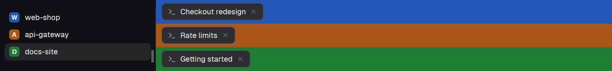

# herdr-colors

**Give every project its own color in [Herdr](https://herdr.dev), so you always know which
project you're looking at.**

Working in many Herdr spaces at once (a `web-shop` here, an `api-gateway` there, a
`docs-site` in a dev container) makes it easy to type into the wrong one. herdr-colors paints
each project in its own color everywhere you look, like per-project title bars in VS Code.



## What you get

| Where | What you see |
|---|---|
| **Tab bar** | The bar behind your tabs takes the project's color |
| **Spaces sidebar** | Each space's letter tile in its project's color |
| **Machines** (dev containers, remote machines) | A colored tile for each, in the color of the project inside it |
| **Agents panel** | A color stripe on every agent, so you see which project each one works in |
| **Window title** | Your OS window title shows the project, e.g. `web-shop - Herdr` |

## What you can do

- **Pick a color where you see it:** right-click a space, machine or agent and choose
  **Color...**.
- **Share it with your team:** **Share via repo** saves the color in the repo
  (`.herdr/color.json`), so everyone who uses Herdr on that repo sees the same color.
- **Keep it to yourself:** **Just for me** saves it only on your computer and leaves the repo alone.
- **Do nothing at all:** every project gets a distinct color automatically and keeps it.
- **Reuse VS Code colors:** if a repo already sets a title bar color in VS Code (or with the
  Peacock extension), Herdr uses it.
- **Dev containers included:** machines and their spaces show their project's color, even while
  a container is stopped.

It stays out of the way: it only writes files when you click a button, runs almost nothing in
the background, and shows edits within a second. See [What it runs and writes](#what-it-runs-and-writes)
and the [user stories](docs/user-stories.md).

## Setting a color

Right-click a space, a machine, an agent or an agents-panel space header:

- **Space:** the menu has **Color...**
- **Machine or agent:** the color picker opens straight away

The picker shows which repo the color applies to (for example `Applies to repo "web-shop" · 2
spaces`) and where the current color comes from. Pick a swatch or type a hex value (with or
without `#`; Enter saves just for you), then:

| Button | What it does |
|---|---|
| **Just for me** | Saves in your own file, `~/.config/herdr-app/project-colors.json`, on this computer |
| **Share via repo** | Writes `.herdr/color.json` in the repo. Others see it once you commit it. Only offered when the repo can be reached and is a git repo |
| **Clear** | Removes both herdr colors; the project goes back to its VS Code color, else an automatic one |

## Where colors come from

First match wins:

1. `.herdr/color.json` in the repo: `{ "color": "#1d4ed8" }` (in a worktree, the worktree's
   own, then the main checkout's)
2. Your file `~/.config/herdr-app/project-colors.json`:
   `{ "vscode": true, "repos": { "<repo name>": "#1d4ed8" } }`. Set `"vscode": false` to ignore
   VS Code colors.
3. VS Code's `.vscode/settings.json` (JSONC): `workbench.colorCustomizations` →
   `titleBar.activeBackground`, or `peacock.color`
4. Automatic: one of 14 colors chosen to be easy to tell apart, all readable with white text.
   A new project gets the one fewest projects use, and keeps it (remembered in Herdr's shared state).

A project is its git repo, named after the main checkout, so worktrees share their repo's
color (bare-repo layouts like `proj.git` or `proj/.bare` too). Repo names match regardless of
letter case and Unicode form. A space outside any git repo is colored by its space name.

**Machines** reached with `docker exec` or `podman exec` (with `sudo`, a full path, `--context`
or `-H` as in the machine's target) are colored as the repo inside them, found through the
container's `devcontainer.config_file` label: read on your disk when that config file is really
on this computer, else inside the container while it runs (the label's path, or the dev
containers default `/workspaces/<repo>`). A stopped container keeps the color it last had; one
never seen running uses your file or the automatic color of its repo name. Other machines get
the automatic color of their name. While a machine is unreachable, its spaces keep their last
color.

Colors update at once after a change in the picker or an edit in a local repo's existing `.herdr` or `.vscode` folder, and within a minute otherwise (new folders, remote machines, containers). Other file activity in your repos (builds, installs, agents editing code) wakes nothing.

## What it runs and writes

So you know before installing:

| What | When |
|---|---|
| `git rev-parse` in a space's folder, on that space's machine | Once per folder a space is in. Again every minute only where it found no repo or couldn't reach the machine. Never on a computer where git can't run (e.g. macOS without developer tools) |
| `docker inspect` (or `podman inspect`, as the machine's target runs it) of each dev container | Once per container |
| `hc machine ls --json` | Every minute, and after a color change |
| Reads `.herdr/color.json` and `.vscode/settings.json` in each repo, and your `project-colors.json` | Every minute. The `.herdr` and `.vscode` folders of local repos, and your file, are also watched, so an edit there shows within a second (a `.herdr` folder created by hand: within a minute) |
| Writes or removes `<repo>/.herdr/color.json`: through PowerShell on Windows (the path is never parsed by `cmd.exe`), through `sh` elsewhere and in containers (paths and text sent base64-encoded, so nothing in them is interpreted). Refuses if `.herdr` or `color.json` is a link or the repo folder isn't there; never creates more than `.herdr` itself | Only when you click **Share via repo** or **Clear** |
| Writes `~/.config/herdr-app/project-colors.json`, keeping everything else in it; refuses if it has a typo | Only when you click **Just for me** or **Clear** |
| Sets the OS window title to `<space> - Herdr` | On every space switch |

No network access. It replaces four of Herdr's panels with patched copies (next section), and
writes Herdr shared-state keys: `space.colors` (Herdr's own map of space colors; a hex color you
set there yourself is left alone) and `project-color.*`.

## Install

Built and tested with herdr-app 0.1.16 and herdr-core (`hc`) 0.1.21 on Windows. Linux and
macOS were reviewed and their shell scripts tested on Linux, but not yet run in a real Herdr
there; reports welcome.

You need:

- **node** (18 or newer) and **jq** (1.6 or newer). macOS: `brew install node jq`.
- The **`herdr-app`** command. On macOS it's installed as `~/.local/bin/herdr-app`, which may
  not be on your PATH; use the full path or add `~/.local/bin`.
- **git** in each environment your spaces run in (2.5 or newer).

The commands below use Herdr's home folder; set `H` once (it honours `$HERDR_APP_HOME`):

```sh
H="${HERDR_APP_HOME:-$HOME/.config/herdr-app}"
```

The tab bar, agents panel, spaces sidebar and right-click menu are Herdr's own mods with small
patches. They are not in this repo: `tools/build-clones.mjs` builds them from the copies in
your Herdr, so they always match your version.

1. Build the patched copies:

   ```sh
   node tools/build-clones.mjs
   ```

   If Herdr changed the code a patch hooks into, it stops with a message and writes nothing.

2. Copy the five mods into Herdr's home and check them. Use real copies: a junction or
   symlink isn't picked up.

   ```sh
   for m in project-color project-color-tabs project-color-agents project-color-spaces project-color-menu; do
     cp -r "mods/$m" "$H/mods/"
     herdr-app check "$H/mods/$m"
   done
   ```

3. Herdr's shipped `main` layout can't take new blocks, so clone it (this also switches to it):

   ```sh
   herdr-app do layout.clone --name main --as colors
   ```

4. In the clone, add a 0px `project-color` block (it draws nothing; it looks colors up) and
   point the panels at the patched copies:

   ```sh
   F="$H/layouts/colors.json"
   jq '(.children[] | select(.id=="work") | .children) |= ([{"id":"project-color","type":"block","size":{"px":0},"content":{"mod":"project-color","props":{"bar":false}}}] + map(select(.id!="project-color")))
       | walk(if type=="object" and (.content?.mod? | IN("tabs","agents","spaces")) then .content.mod = "project-color-" + .content.mod else . end)' "$F" > "$F.tmp" && mv "$F.tmp" "$F"
   ```

   The window updates within a second. If nothing changes, look for `layouts/colors.error`.

**After a Herdr update**, repeat steps 1 and 2.

To go back: `ctrl-shift-l` (or `herdr-app do layout.switch --name main`). To uninstall,
delete `layouts/colors.json` and the five `mods/project-color*` folders. Space tiles keep their
last colors until you change them in Herdr.

## Develop

```sh
node --test test/color.test.mjs
```

`mods/project-color/color.js` holds the pure logic (JSONC, lookup order, palette and
assignment, the personal file, devcontainer labels, worktrees, the write scripts) and is what
the tests cover. `main.js` is the Herdr side: lookups, publishing, the picker. The patches to
Herdr's mods live in `tools/build-clones.mjs`. After editing, copy the folder into Herdr's
`mods/` again; saving there reloads the mod live.
